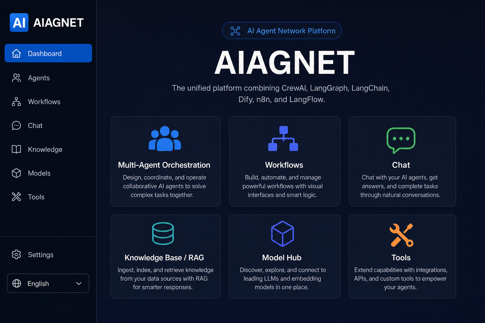

# AI-AGENT

**Digital Employee Platform** — Digital employees connect thinking, skills, workflows, knowledge, and scheduled tasks into one complete AI workforce pipeline.

[](https://github.com/oymclihui/AI-Agent)

**Languages:** [中文](README.md) · **English**

<p align="center">
  
</p>

---

## Features

| Module | Description |
|--------|-------------|
| **Agents** | Create and manage agents; **private by default**; rename, **share to users/departments**, **org-wide publish**, copy shared agents; list scopes (mine / shared / org / platform / usable) |
| **Skills** | Reusable SOPs, online library (~1123 templates), runtime injection; **admin-only delete** |
| **Chat** | Multi-turn dialogue, **SessionContext** (agent/skill/KB/model/connector), **chat RAG**, smart deposit, attachments |
| **Knowledge** | Document upload, vector search, multi-KB chat RAG; seeded platform roadmap with **content_sha256 re-index** |
| **Digital Employees** | Role-based agents with **multiple Cron / interval tasks**; **one-click import from 11 bundled templates** |
| **Operations Screen** | Full-screen **`/screen`**: KPIs, employee status, task trends; Dashboard API + SSE |
| **Workflows** | n8n-style designer (675+ nodes), **NL workflow generation**, AI node config assistant |
| **Model Hub** | Model config **CRUD**, set default, **inference params**, OpenAI-compatible Base URL |
| **Users & auth** | Employee no / email login, JWT, **per-user data isolation**, **personal model API keys** |
| **Tools** | Built-in calculator, HTTP, web search, datetime tools |
| **DataAsk** | **SQL Q&A** on PostgreSQL/VastBase/MySQL/Doris/Hive/HANA + **ephemeral Excel** analysis (Python/pandas/ML); row-level permissions, audit |
| **Orchestrator** | Multi-agent collaboration (CrewAI-style sequential flows) |

The frontend supports **Chinese / English** UI.

---

## Changelog

### 2026-06 — DataAsk (NL→SQL + ephemeral Excel analysis)

- **Database Q&A:** wizard connect → pick tables + permission table → semantic model → Chat / quick ask
- **Drivers:** postgresql, vastbase, mysql, doris, hive, hana
- **Excel ephemeral mode (Plan B):** upload `.xlsx/.xls/.csv`, select files, generate **Python**, run; **files auto-deleted after successful execution** (50MB/file, 200MB/folder quotas)
- **API:** `/data-sources/*`, `/data-ask/query`
- **Tests:** `backend/scripts/smoke_test_data_ask.py`, `test_excel_ephemeral.py`

See [README.md (中文)](README.md) for full details.

### 2026-06 — Self-contained Windows release zip

**Summary:** Unzip and double-click `AI-AGENT.bat` — **no Python or Node.js install** on the target PC.

| Item | Details |
|------|---------|
| **Bundled runtime** | `runtime/python/` (Python 3.12 + backend deps), `runtime/node/` (Node 20) |
| **Pre-built app** | `pip install`, `npm ci`, and `next build` run on the packager machine |
| **Launch** | `AI-AGENT.bat` → `launch.ps1` → `start_prod.ps1`; errors logged to `ai-agent-start.log` |
| **Still required** | **PostgreSQL or VastBase** (configured via `/setup`) |

```powershell
.\scripts\package_win_release.ps1   # output: release\aiagnet-win-YYYYMMDD-HHmm.zip
```

See [Windows delivery package](#windows-delivery-self-contained) and [README.md](README.md#windows-交付包自包含) (Chinese).

### 2026-06 — Agent visibility & sharing

**Summary:** New agents are private by default. Owners can rename, share to users/departments, publish org-wide, or copy agents shared with them.

| Capability | Details |
|------------|---------|
| **Visibility** | `private` → `shared` (grants) → `org` → `platform` (bundled, no owner) |
| **List scopes** | `?scope=mine\|shared\|org\|platform\|usable\|all`; chat & employees use `usable` |
| **Sharing API** | Owner `GET/PUT /agents/{id}/sharing`; `GET /agents/share-targets` |
| **Copy** | `POST /agents/{id}/copy` — duplicate shared/org/platform agent as private |
| **Rename** | Owners can rename their agents (syncs `metadata.i18n.name`) |
| **Delete** | Owners delete own agents; admins delete platform agents; skills still admin-only |
| **Audit** | Share changes logged to `agent_share_audit_logs` |
| **Migration** | Auto-adds `visibility`, `agent_shares`, `agent_share_audit_logs` on startup |

```bash
cd backend
python scripts/smoke_test_agent_permissions.py   # 21 checks
```

### 2026-06 — Organization permission Excel import

**Summary:** Org admins and delegation roles can bulk-update user roles via Excel (template download, preview, apply).

| Capability | Details |
|------------|---------|
| **Template** | 4 sheets: import data, instructions, role reference, department reference |
| **Flow** | Download → upload → **preview** (green/yellow/red) → confirm apply |
| **UI** | `/settings/organization` — table, search, role presets, **Bulk import** tab |
| **Delegation** | Dept liaison & executive secretary pages include scoped import |
| **API** | `GET/POST /organization/permissions/import/*` and `/organization/delegation/permissions/import/*` |

```bash
cd backend
python scripts/smoke_test_permission_import.py   # 7 checks
python scripts/run_launch_preflight.py           # pre-launch suite
```

### 2026-06 — SessionContext integration (P0 shipped)

**Summary:** What you pick in chat (skills / knowledge bases) is what runs at inference time and what gets linked after deposit.

| Capability | Details |
|------------|---------|
| **SessionContext** | Unified agent / skill / KB / model / connector; persisted via `PATCH /chat/conversations/{id}/context` |
| **Skill injection** | Merges `conversation.skills_config` + `agent.skills_config`; skills work without selecting an agent |
| **Chat RAG** | Multi-KB retrieval (including BYD KMS); streaming and non-streaming |
| **Deposit linking** | Skill ↔ KB auto-bind on confirm; writes back to current conversation |
| **Single extract** | `suggest-deposit` draft reused on confirm (LLM fallback if body missing) |
| **Permissions** | Delete skills — **admins only**; agents — **owners delete own**, admins manage platform |

**New / updated APIs:** `GET/PATCH /chat/conversations/{id}/context`, enhanced `POST .../messages`.

Full spec: [README.md — 技能 · 知识 · 对话 · 沉淀整合](README.md#技能--知识--对话--沉淀整合)

---

## Recent Additions

### Skills

- Create and edit skills in-platform (Markdown instructions, description, publish status)
- **Online skill library**: import from [Anthropic official skills](https://github.com/anthropics/skills), [Agent Skills Hub](https://github.com/agent-skills-hub/agent-skills-hub), and [SkillHub China](https://skillhub.cn/) (~**1123** templates)
- Bundled **`data-qa-intent`** (data Q&A intent, smart-qa-inspired); startup seeds include code review and commit message skills
- **Bilingual skill labels**: `metadata.i18n` + API `?lang=zh|en`, follows UI language
- Bind skills when creating or editing agents; SOPs are injected during chat and agent task runs
- Separation: Knowledge = facts; Skills = how to work

### Digital Employees

- Wrap an agent as a “role”: name, title, bound agent, timezone
- Each employee can have **multiple scheduled tasks** (Cron or fixed interval)
- Current task type: **Agent prompt tasks** (`task_config.prompt`)
- **`GET /employees/templates` + import**: 11 bundled role templates (research, marketing, security, analytics, …)
- Background scheduler polls every 30s; supports **run now** and **run history**
- Sample seed on startup: employee “小研” with a weekday 9:00 briefing task

### Operations Screen

- Full-screen **`/screen`**: KPIs, employee cards, today’s tasks, hourly trends, run rankings
- Backend **`/api/v1/dashboard/overview`** and **`/stream`** (SSE); timezone **Asia/Shanghai**
- Entry from home page and sidebar

### Workflow Enhancements

- Create workflows via **natural language** or manual form; opens designer after NL generation
- Node catalog generated from the official n8n repo (**675+ nodes**)
- Designer: collapsible palette, drag/add nodes, AI-assisted node configuration

### Branding & deployment

- Product name unified as **AI-AGENT** (UI, API docs, `APP_NAME` config)
- **Remote Linux deploy scripts**: `backend/scripts/remote_deploy.py`, etc. (systemd + Nginx)
- Root **`docker-compose.yml`** (PG / Redis / Chroma / backend / frontend / Nginx); Ollama on host — one-click flow still WIP

### Agent visibility & sharing (Agents ACL)

- New agents default to **`private`** — visible only to the owner
- **Share dialog**: set `shared` with user/department grants, or `org` for org-wide access
- **List tabs**: Mine / Shared with me / Organization / Platform / All (admin)
- **Copy**: one-click private copy of shared, org, or platform agents
- **Rename**: pencil icon on owned agents
- **Access checks**: chat binding, employee agent picker, and `POST /agents/{id}/run` use `require_agent_use`
- **Platform agents**: Agency library imports use `platform` visibility (`owner_id IS NULL`)

### Model Hub, Chat & Auth (latest)

- **SessionContext**: chat toolbar selections persist and restore per conversation
- **Chat RAG**: selected knowledge bases are retrieved and injected into replies
- **Smart deposit**: analyze → preview → confirm with Skill/KB/Agent/Employee linking
- **Model Hub CRUD** with inference params and OpenAI-compatible Base URL
- **Chat**: attachments → suggested questions; session delete / clear-all; 30-day retention
- **Admin-only delete** for skills; **owners delete own agents**, admins manage platform agents
- **Login**: JWT; per-user isolation; personal API keys in Settings

See **[User Guide (中文)](docs/用户操作手册.md)** for step-by-step instructions.

---

## Tech Stack

**Backend**

- Python 3.11+ · FastAPI · SQLAlchemy (async) · SQLite (default)
- LangChain · LangGraph · Ollama
- ChromaDB (local, default) / Milvus (optional)
- Uvicorn

**Frontend**

- Next.js 14 · React 18 · TypeScript
- Tailwind CSS · Radix UI · React Flow
- Zustand · Axios

---

## Project Structure

```
AI-Agent/
├── backend/
│   ├── app/
│   │   ├── api/          # REST API routes
│   │   ├── core/         # Agents, workflows, dialogue, tools, skills, employee scheduler
│   │   │   ├── auth/         # JWT, agent ACL, user data scope
│   │   │   ├── skills/       # Skill injection & online library
│   │   │   ├── employees/    # Scheduled task runner & scheduler
│   │   │   └── workflow/     # Engine, node catalog, NL generator
│   │   ├── db/           # Database models & seed data
│   │   ├── knowledge/    # RAG pipeline & vector store
│   │   └── models_hub/   # LLM routing & invocation
│   └── smoke_test.py     # End-to-end smoke test
├── frontend/
│   └── src/
│       ├── app/          # Next.js pages
│       ├── components/   # UI components
│       └── lib/          # API client, i18n
├── docs/                 # Screenshots
├── README.md             # Chinese documentation
└── README.en.md          # English documentation (this file)
```

---

## Requirements

- **Python** 3.11+
- **Node.js** 20+
- **Ollama** (recommended for local LLM): [https://ollama.com](https://ollama.com)
  - Default model: `qwen3.6:35b`
  - Default embedding: `nomic-embed-text` (`ollama pull nomic-embed-text`)
- Optional: Milvus, Redis, MinIO (SQLite / Chroma / local filesystem used when not configured)

---

## Quick Start

### 1. Clone the repository

```bash
git clone https://github.com/oymclihui/AI-Agent.git
cd AI-Agent
```

### 2. Start the backend

```bash
cd backend

python -m venv .venv

# Windows
.venv\Scripts\activate

# macOS / Linux
source .venv/bin/activate

pip install -r requirements.txt

copy .env.example .env   # Windows
# cp .env.example .env   # macOS / Linux

uvicorn app.main:app --reload --host 0.0.0.0 --port 8000
```

> Digital employee Cron scheduling requires `croniter` (listed in `requirements.txt`).

Once running:

- Health check: http://localhost:8000/health
- API docs: http://localhost:8000/docs

### 3. Start the frontend

```bash
cd frontend
npm install

copy .env.example .env.local   # Windows
# cp .env.example .env.local   # macOS / Linux

npm run dev
```

Open **http://localhost:3000** in your browser. Switch language via the sidebar toggle (中文 / English).

### 4. Run smoke tests

With the backend running:

```bash
cd backend
python smoke_test.py
```

Expected: `14 passed, 0 failed` (requires Ollama with the configured models).

---

## Configuration

| File | Purpose |
|------|---------|
| `backend/.env.example` | Backend env template → copy to `backend/.env` |
| `frontend/.env.example` | Frontend API URL → copy to `frontend/.env.local` |
| `backend/requirements.txt` | Pinned Python dependencies |

Quick setup:

```bash
cd backend && cp .env.example .env
cd frontend && cp .env.example .env.local
```

Key variables: `OLLAMA_BASE_URL`, `DEFAULT_LLM_MODEL`, `OPENAI_API_KEY`, `VECTOR_STORE_TYPE` (`chroma` / `milvus`).

> **Note:** Never commit `.env` files. They are excluded via `.gitignore`.

---

## API Overview

All endpoints are under `/api/v1`:

| Path | Purpose |
|------|---------|
| `/agents` | Agent CRUD, **scoped lists**, **sharing**, **copy**, run; `GET/PUT /{id}/sharing`, `GET /share-targets` |
| `/skills` | Skill CRUD; `/skills/library/*` online catalog browse & import |
| `/employees` | Digital employees, **template import**, scheduled tasks, manual run, run history |
| `/dashboard` | Operations screen overview & SSE stream |
| `/workflows` | Workflow CRUD, execution, NL generate, node catalog, AI config assistant |
| `/chat` | Conversations, SessionContext (`GET/PATCH context`), chat RAG, smart deposit, save as skill/KB |
| `/knowledge` | Knowledge bases & document search |
| `/models` | Model configs & available models |
| `/tools` | Tool registry |
| `/orchestrator` | Multi-agent orchestration |

Full reference: http://localhost:8000/docs

---

## Docker

**Compose (initial, experimental)**

```bash
# Requires Ollama on host (default http://host.docker.internal:11434)
docker compose up -d
```

Includes PostgreSQL, Redis, Chroma, backend, frontend, and Nginx. Change secrets in `.env` before production use.

**Frontend image only**

```bash
cd frontend
docker build -t aiagnet-frontend .
docker run -p 3000:3000 aiagnet-frontend
```

---

## Windows delivery (self-contained)

For **Windows 10/11 demo / intranet** machines — **Python and Node.js are bundled** inside the zip.

| Step | Action |
|------|--------|
| Pack (dev) | `.\scripts\package_win_release.ps1` |
| Deploy | Unzip fully → double-click **`AI-AGENT.bat`** |
| First run | Open `SETUP_TOKEN.admin.txt` → `http://localhost:3000/setup` → configure PostgreSQL / VastBase |
| Login | `admin / admin123` after DB init + restart |

The zip includes `runtime/python`, `runtime/node`, `frontend/.next`, and `frontend/node_modules` (~1GB+). If the window closes immediately, check **`ai-agent-start.log`**.

Docs: [docs/单位部署与首次登录.md](docs/单位部署与首次登录.md) · [docs/Windows交付说明.md](docs/Windows交付说明.md)

---

## Skills · Knowledge · Chat · Deposit Integration

> **Status: P0 shipped (2026-06); P1/P2 planned**

See the full specification in the Chinese README:

**[README.md — 技能 · 知识 · 对话 · 沉淀整合](README.md#技能--知识--对话--沉淀整合)**

| Phase | Status | Focus |
|-------|--------|--------|
| **P0** | ✅ Shipped | SessionContext, PATCH context, skill merge + RAG, deposit auto-link, admin delete |
| **P1** | Planned | `deposit_bundles`, `/deposits` workspace, pre-publish edit, dedup |
| **P2** | Planned | Hybrid RAG, citations, unified deposit from desktop/employee runs |

Related: [docs/知识库增强规划.md](docs/知识库增强规划.md)

---

## Roadmap

Future plans are stored in the seeded knowledge base **「AI-AGENT 平台文档」** (auto-created on backend startup from `platform-roadmap.md`). Search it on the **Knowledge** page, e.g. “What is Digital Employees Phase 2?”

- [x] P0: SessionContext — conv `skills_config`, PATCH context, chat skill/RAG wiring
- [x] P0: Deposit confirm linking + single LLM extract (draft reuse)
- [ ] P1: Deposit bundles + `/deposits` workspace
- [ ] P2: Hybrid RAG + citations + multi-source deposit hub
- [x] Delete permissions (skills: admin; agents: owner / platform admin)
- [x] Agent visibility & sharing ACL (private / shared / org / platform, copy, rename, scopes)

- [x] n8n-style workflow node catalog & designer
- [x] Natural-language workflow / agent creation
- [x] Skills module & online library (SkillHub.cn, data-qa-intent, skill i18n)
- [x] Digital employees with Cron scheduled tasks
- [x] Employee templates (including analytics roles)
- [x] Operations screen `/screen` & Dashboard API
- [x] Remote deploy scripts (Linux + systemd + Nginx)
- [x] Feishu / DingTalk IM bot integration
- [x] Chat chart / KPI structured rendering
- [x] Scheduled tasks for workflows & crew orchestration
- [x] Save as skill / knowledge from chat; smart deposit (SessionContext P0)
- [x] User authentication & organization RBAC UI (**Excel bulk permission import**)
- [~] Docker Compose one-click deployment (compose file exists, WIP)

---

## License

No open-source license has been assigned yet. Contact the author before commercial use or redistribution.

---

## Links

- Repository: [https://github.com/oymclihui/AI-Agent](https://github.com/oymclihui/AI-Agent)
- Chinese README: [README.md](README.md)
