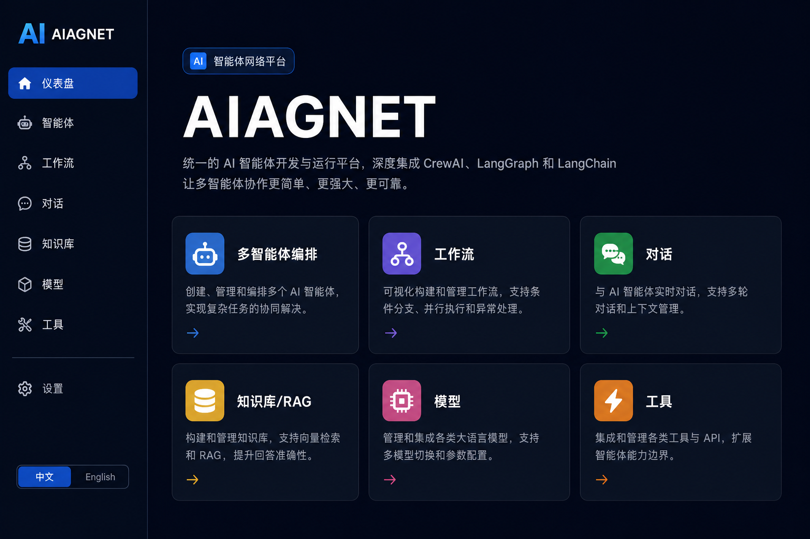

# AI-AGENT

**统一 AI 智能体平台** — 融合多智能体编排、可视化工作流、技能沉淀、数字员工定时任务、RAG 知识库与模型管理。

[](https://github.com/oymclihui/AI-Agent)

**语言 / Languages：** **中文** · [English](README.en.md)

<p align="center">
  
</p>

---

## 功能概览

| 模块 | 说明 |
|------|------|
| **Agents** | 创建与管理智能体，支持角色、目标、工具绑定、**技能绑定**与自然语言生成 |
| **Skills** | 可复用 SOP / 方法论沉淀（对齐 Cursor `SKILL.md`），支持在线技能库导入与运行时注入 |
| **Digital Employees** | **数字员工**：岗位化绑定智能体，一个员工可挂载多个 **Cron / 间隔定时任务**，自动执行 Agent 任务 |
| **Workflows** | n8n 风格可视化设计器（675+ 节点库）、**自然语言生成工作流**、节点 AI 配置助手 |
| **Chat** | 多轮对话、流式输出、会话记忆（绑定 Agent 时自动注入技能） |
| **Knowledge** | 文档上传、向量检索（RAG），支持 Ollama 嵌入模型 |
| **Model Hub** | 统一管理 OpenAI、Anthropic、Ollama 等 LLM 配置 |
| **Tools** | 内置计算器、HTTP 请求、网页搜索、日期时间等工具 |
| **Orchestrator** | 多智能体协同编排（CrewAI 风格 sequential 流程） |

前端支持 **中 / 英** 双语界面。

---

## 近期新增功能

### 技能（Skills）

- 平台内创建 / 编辑技能（Markdown 指令 + 描述 + 发布状态）
- **在线技能库**：从 [Anthropic 官方](https://github.com/anthropics/skills) 与 [Agent Skills Hub](https://github.com/agent-skills-hub/agent-skills-hub) 浏览并批量导入（810+ 模板）
- 智能体创建 / 编辑时可绑定技能；对话与 Agent 任务执行时自动注入 SOP
- 与知识库分工：Knowledge = 事实文档，Skill = 怎么做

### 数字员工（Digital Employees）

- 将智能体包装为「岗位」：名称、职责、绑定 Agent、时区
- 每个员工可配置 **多个定时任务**（Cron 或固定间隔）
- 任务类型（当前）：**Agent 指令任务**（`task_config.prompt`）
- 后台调度器每 30 秒扫描到期任务；支持 **立即执行** 与 **执行记录** 查询
- 启动时自动加载示例：员工「小研」+ 工作日 9:00 早报任务

### 工作流增强

- 新建工作流支持 **自然语言** 与 **手动填写** 两种模式，AI 生成后跳转设计器
- 节点库从 n8n 官方仓库生成，含触发器、AI、集成等 **675+ 节点**
- 设计器：分类折叠节点面板、拖拽 / 添加、右侧 AI 辅助配置

### 品牌

- 产品名称统一为 **AI-AGENT**（界面、API 文档、配置项 `APP_NAME`）

---

## 技术栈

**Backend**

- Python 3.11+ · FastAPI · SQLAlchemy (async) · SQLite（默认）
- LangChain · LangGraph · Ollama
- ChromaDB（本地向量库，默认）/ Milvus（可选）
- Uvicorn

**Frontend**

- Next.js 14 · React 18 · TypeScript
- Tailwind CSS · Radix UI · React Flow
- Zustand · Axios

---

## 项目结构

```
AI-Agent/
├── backend/
│   ├── app/
│   │   ├── api/          # REST API 路由
│   │   ├── core/         # 智能体、工作流、对话、工具、技能、数字员工调度
│   │   │   ├── skills/       # 技能注入、在线技能库
│   │   │   ├── employees/    # 定时任务调度与执行
│   │   │   └── workflow/     # 工作流引擎、节点库、NL 生成
│   │   ├── db/           # 数据库模型与初始化
│   │   ├── knowledge/    # RAG 管道与向量存储
│   │   └── models_hub/   # LLM 路由与调用
│   └── smoke_test.py     # 端到端冒烟测试
├── frontend/
│   └── src/
│       ├── app/          # Next.js 页面
│       ├── components/   # UI 组件
│       └── lib/          # API 客户端、i18n
└── README.md
```

Screenshots: [`docs/screenshot.png`](docs/screenshot.png) (中文) · [`docs/screenshot-en.png`](docs/screenshot-en.png) (English)

---

## 环境要求

- **Python** 3.11+
- **Node.js** 20+
- **Ollama**（推荐，本地 LLM）：[https://ollama.com](https://ollama.com)
  - 默认模型：`qwen3.6:35b`
  - 默认嵌入模型：`nomic-embed-text`（`ollama pull nomic-embed-text`）
- 可选：Milvus、Redis、MinIO（不配置时使用本地 SQLite / Chroma / 文件系统）

---

## 快速开始

### 1. 克隆仓库

```bash
git clone https://github.com/oymclihui/AI-Agent.git
cd AI-Agent
```

### 2. 启动后端

```bash
cd backend

# 创建虚拟环境
python -m venv .venv

# Windows
.venv\Scripts\activate

# macOS / Linux
source .venv/bin/activate

# 安装依赖
pip install -r requirements.txt

# 配置环境变量（复制示例文件后按需修改）
copy .env.example .env   # Windows
# cp .env.example .env   # macOS / Linux

# 启动 API 服务（Windows 也可在项目根目录执行 start_backend.ps1）
uvicorn app.main:app --reload --host 0.0.0.0 --port 8000
```

> 数字员工 Cron 调度依赖 `croniter`，已包含在 `requirements.txt`。若手动安装：`pip install croniter`。

后端启动后访问：

- 健康检查：http://localhost:8000/health
- API 文档：http://localhost:8000/docs

### 3. 启动前端

```bash
cd frontend
npm install

# 可选：自定义后端地址
copy .env.example .env.local   # Windows
# cp .env.example .env.local   # macOS / Linux

npm run dev
```

浏览器打开 **http://localhost:3000**（Windows 也可执行 `start_frontend.ps1` 或根目录 `start.ps1` 一键启动前后端）

### 4. 运行冒烟测试

确保后端已启动，然后：

```bash
cd backend
python smoke_test.py
```

预期输出：`14 passed, 0 failed`（需 Ollama 可用且已拉取相应模型）。

---

## 配置说明

| 文件 | 说明 |
|------|------|
| `backend/.env.example` | 后端全部环境变量模板，复制为 `backend/.env` |
| `frontend/.env.example` | 前端 API 地址，复制为 `frontend/.env.local` |
| `backend/requirements.txt` | Python 依赖锁定列表 |

一键配置示例：

```bash
# 后端
cd backend && cp .env.example .env

# 前端
cd frontend && cp .env.example .env.local
```

常用项：`OLLAMA_BASE_URL`、`DEFAULT_LLM_MODEL`、`OPENAI_API_KEY`、`VECTOR_STORE_TYPE`（`chroma` / `milvus`）。

> **注意**：请勿将 `.env` 提交到 Git。仓库已通过 `.gitignore` 排除敏感文件。

---

## API 概览

所有接口前缀：`/api/v1`

| 路径 | 功能 |
|------|------|
| `/agents` | 智能体 CRUD、运行、技能绑定 |
| `/skills` | 技能 CRUD；`/skills/library/*` 在线技能库浏览与导入 |
| `/employees` | 数字员工 CRUD、定时任务、手动执行、运行记录、调度状态 |
| `/workflows` | 工作流管理、执行、NL 生成、节点库、AI 配置助手 |
| `/chat` | 对话与会话 |
| `/knowledge` | 知识库与文档检索 |
| `/models` | 模型配置与可用模型列表 |
| `/tools` | 工具注册表 |
| `/orchestrator` | 多智能体编排 |

完整接口见 Swagger UI：http://localhost:8000/docs

---

## Docker（前端）

```bash
cd frontend
docker build -t aiagnet-frontend .
docker run -p 3000:3000 aiagnet-frontend
```

---

## 开发路线

以下规划已写入知识库 **「AI-AGENT 平台文档」**（启动后端时自动创建并嵌入 `platform-roadmap.md`），可在 **Knowledge** 页检索，例如：「数字员工 Phase 2 计划是什么？」

- [x] n8n 风格工作流节点库与设计器
- [x] 自然语言创建工作流 / 智能体
- [x] 技能模块与在线技能库导入
- [x] 数字员工与 Cron 定时任务
- [ ] 定时任务支持工作流 / 多 Agent 编排执行
- [ ] 从对话 / 执行记录「保存为技能」
- [ ] 用户认证与多租户
- [ ] Docker Compose 一键部署

---

## 许可证

本项目尚未指定开源许可证。如需商用或二次分发，请联系作者确认。

---

## 链接

- 仓库：[https://github.com/oymclihui/AI-Agent](https://github.com/oymclihui/AI-Agent)
- 英文说明：[README.en.md](README.en.md)
