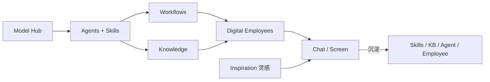

# AI-AGENT 平台产品规划与开发路线

> 本文档描述 AI-AGENT 统一智能体平台的**产品说明**、**已完成功能**与**未来规划**，供产品、研发与智能体检索参考。  
> 启动时会自动写入平台知识库；`content_sha256` 变更后自动再索引。  
> **最后更新：2026-06-12**

**相关文档：**

| 文档 | 说明 |
|------|------|
| [README.md](../../../../README.md) | 项目介绍、安装与快速开始 |
| [docs/用户操作手册.md](../../../../docs/用户操作手册.md) | 用户操作步骤 |
| [docs/桌面自动化与Harness说明.md](../../../../docs/桌面自动化与Harness说明.md) | 桌面 Sidecar + Harness 工具确认 |
| [docs/打包部署方案.md](../../../../docs/打包部署方案.md) | Windows / Linux / Docker 部署 |
| [docs/知识库增强规划.md](../../../../docs/知识库增强规划.md) | 知识库 Phase 1–4 增强计划（尚未实施） |

---

## 一、平台定位

**AI-AGENT** 是面向企业的**数字员工平台**：把「会思考、有技能、懂流程、有知识、能定时干活」连成一条完整的 AI 上岗链路。

### 1.1 核心分层

| 层级 | 模块 | 职责 | 一句话 |
|------|------|------|--------|
| 事实层 | **Knowledge（知识库）** | 文档、制度、报表、对话沉淀 | 知道什么 |
| 方法层 | **Skills（技能）** | SOP、方法论（对齐 Cursor `SKILL.md`） | 怎么做 |
| 能力层 | **Tools（工具）** | 搜索、HTTP、邮件、计算、PPT 等 | 能做什么 |
| 角色层 | **Agents（智能体）** | 角色、目标、工具与技能绑定 | 谁来做 |
| 流程层 | **Workflows（工作流）** | n8n 风格可视化编排 | 怎么串 |
| 岗位层 | **Digital Employees（数字员工）** | 岗位化 Agent + Cron 定时任务 | 谁在岗 |
| 体验层 | **Chat / Inspiration / Screen** | 对话、灵感 Lowcode、运营大屏 | 怎么用 |

### 1.2 上岗链路

**典型路径**：Model Hub → Agents（+Skills）→ Workflows / Knowledge → Digital Employees（定时任务）→ Chat / 大屏 / 外部渠道（规划）。

### 1.3 前端导航（侧边栏）

| 路由 | 模块 |
|------|------|
| `/` | 首页仪表盘 |
| `/screen` | 运营大屏 |
| `/employees` | 数字员工 |
| `/agents` | 智能体 |
| `/skills` | 技能 |
| `/workflows` | 工作流 |
| `/chat` | 对话 |
| `/knowledge` | 资料库 |
| `/inspiration` | 灵感（Lowcode / 模板） |
| `/models` | 模型配置 |
| `/tools` | 工具列表 |
| `/settings` | 设置（主题、邮箱、个人 Key 等） |

---

## 二、已完成功能

### 2.1 对话（Chat）

- [x] 多轮对话、**流式输出**、会话持久化（服务重启后从 DB 恢复）
- [x] **附件上传**与 LLM **推荐问题**（`POST /chat/suggest-questions`）
- [x] **语音输入**：浏览器录音 + 后端转写（`POST /chat/transcribe`）
- [x] 会话 **单条删除 / 清空全部**；`CONVERSATION_RETENTION_DAYS` 自动清理过期会话
- [x] **沉淀导出**：会话 **存为技能** / **存入知识库**（Markdown 入库并索引）
- [x] **对话上岗沉淀（Deposit）**：AI 分析对话是否值得沉淀 → 推荐技能 / 知识 / 智能体 / 数字员工 → 用户确认一键创建（`suggest-deposit` / `deposit/confirm`）
- [x] 对话绑定 **知识库**、**智能体**、附件上下文
- [x] 场景胶囊（如十二周销量分析等业务快捷入口）
- [x] 产物 **Artifacts** 下载（`GET /api/v1/artifacts/{filename}`）

### 2.2 智能体（Agents）

- [x] CRUD：角色、目标、背景、工具绑定、技能绑定、温度等
- [x] **自然语言生成智能体**
- [x] **在线智能体库（Agency Agents）**：
  - 英文源：`msitarzewski/agency-agents`
  - 中文源：`jnMetaCode/agency-agents-zh`
  - 目录约 **287** 个角色模板；支持 sync / import / 按 division 浏览
  - API：`/api/v1/agents/library/*`
- [x] 智能体 **中英双语展示**（`metadata.i18n`）
- [x] 执行器对接 Model Hub、SkillInjector、工具注册表

### 2.3 技能（Skills）

- [x] 平台内创建 / 编辑（Markdown 指令、描述、发布状态）
- [x] 对齐 Cursor **`SKILL.md`** 结构
- [x] **在线技能库**（约 **1123** 模板）：Anthropic 官方 + Agent Skills Hub + **SkillHub 中国社区**
- [x] API：`/library/catalog`、`/library/import`、`/library/sync`、`/seed-bundled`
- [x] 内置 **`data-qa-intent`**（数据问答意图识别，12 类意图 + `[kpi]`/`[chart]`/`[choices]` 协议）
- [x] 其他内置：代码审查、Git 提交信息、`huashu-design`、`html2pptx`、`mailbox-assistant` 等
- [x] **技能中英双语**（`?lang=zh|en`）
- [x] 运行时 **SkillInjector** 注入 Agent / 对话上下文

### 2.4 数字员工（Digital Employees）

- [x] CRUD：岗位名称、职责、绑定 Agent、时区、技能配置
- [x] 每员工多个 **定时任务**（Cron 或固定间隔）
- [x] 任务类型（当前）：**Agent 指令任务**（`task_config.prompt`）
- [x] 进程内调度器（30 秒轮询）、**立即执行**、**执行记录**
- [x] 启动种子：员工「小研」+ 工作日 9:00 早报
- [x] **从模板导入**：`GET /employees/templates`、`POST /employees/import-template`
- [x] **执行结果导出知识库**（`export_run_to_knowledge`）
- [x] bundled 岗位模板 JSON（`backend/app/core/employees/templates/`），当前 **8** 个：

| template_id | 名称 | 类别 |
|-------------|------|------|
| nev-cfo-monthly-board | 制造集团 CFO（月度董事会） | finance |
| nev-vp-finance-weekly | 财务 VP（周例会） | finance |
| nev-controller-manufacturing-daily | 制造 Controller（日监控） | finance |
| nev-fpa-rolling-weekly | FP&A 滚动预测（周报） | finance |
| nev-treasury-weekly | 司库（周报） | finance |
| nev-cost-accounting-weekly | 成本会计（周报） | finance |
| nev-tax-subsidy-monthly | 税务与政策补贴（月报） | finance |
| weekly-sales-12w-report | 十二周销量分析报告 | analytics |

> 模板面向 **制造企业集团财务** 与 **销量分析** 场景；界面文案已统一为「制造企业」表述。

### 2.5 工作流（Workflows）

- [x] n8n 风格可视化设计器（React Flow）
- [x] **675+ 节点** 目录（从 n8n 官方仓库生成）
- [x] **自然语言生成工作流**（`POST /workflows/generate`）
- [x] 节点 **AI 配置助手**、分类折叠面板、拖拽与右侧配置
- [x] 内置可执行节点：Start / End / Agent / LLM / Tool / Condition / Code / HTTP 等
- [x] bundled 工作流模板，含 **十二周销量分析**（`weekly-sales-12w.json`：Code 指标 → LLM 报告）
- [x] **工作流执行引擎**（`POST /workflows/{id}/execute`）
- [x] 中英双语节点目录与界面

### 2.6 知识库（Knowledge / 资料库）

- [x] 本地知识库：PDF / DOCX / TXT / MD / HTML / URL 上传
- [x] 向量检索 RAG：**Chroma**（本地/容器）/ **Milvus**（远程，如 GPU 服务器）
- [x] 文档 **storage_path** 持久化、原文预览、chunk 列表
- [x] **BYD KMS 外部 RAG**：API 型知识库（`source_type=byd_kms`），连接测试与检索
- [x] **平台文档知识库**：启动种子本文档；**content_sha256 变更自动再索引**
- [x] 对话 / 数字员工执行 **导出到知识库**
- [ ] 混合检索 / Rerank / 逐句溯源 → 见 [知识库增强规划](../../../../docs/知识库增强规划.md)

### 2.7 灵感（Inspiration）

- [x] 前端 **`/inspiration`**：场景模板画廊（分类、收藏、预览）
- [x] 模板编辑：JSON / HTML / Prompt 多 Tab；导出完整 HTML
- [x] **LowcodeEngine 设计器**（`/inspiration/[id]/designer`）：静态资源 `public/lowcode/designer/`
- [x] 与 Chat **一键启动**（`launchInspiration`）
- [x] 本地 override 持久化（浏览器 localStorage）

### 2.8 运营大屏（Operations Screen）

- [x] 全屏 **`/screen`**：KPI、员工墙、任务 Feed、小时趋势、执行排行
- [x] **`GET /dashboard/overview`** + **`/stream`**（SSE 实时刷新）
- [x] 时区 **Asia/Shanghai**、轮播幻灯片、打印友好

### 2.9 Model Hub 与 Tools

- [x] 模型配置 CRUD、设默认、**推理参数**（temperature / top_p / max_tokens 等）
- [x] **OpenAI 兼容 Base URL**（Ollama、BYD EIS 内网网关等）
- [x] 启动种子模型；用户修改不被覆盖
- [x] **个人模型 Key**（设置页，优先于全局 `.env`）
- [x] 内置工具：web_search、calculator、http_request、get_datetime、create_presentation、fetch_mail 等

### 2.10 用户、权限与体验

- [x] 工号 / 邮箱 + 密码登录；JWT 鉴权
- [x] 忘记密码 / 重置密码（SMTP 可配置）
- [x] **按用户隔离**（`owner_id`）；平台模板 `owner_id=null`
- [x] **组织 RBAC（生产级）**：部门树、`departments.path` 子树可见
- [x] **8 角色**：super_admin / org_admin / executive / dept_leader / operator / auditor / **dept_liaison** / **executive_assistant**
- [x] **分层赋权**：Admin 定组织 → **部门接口人**（本部门权限页）→ **高管秘书**（高管权限页）
- [x] 数字员工 + 运营大屏 **按 scope 过滤**；大屏 SSE 需登录
- [x] **赋权审计** `permission_audit_logs`
- [x] 设置页：**组织与权限**、**本部门权限**、**高管权限**
- [x] 前端 **中 / 英** 双语（i18n）
- [x] **深色 / 浅色主题**（ThemeProvider + 设置页）
- [x] 默认管理员：`admin` / `admin123`（`.env` 可改）

> 说明文档：`docs/组织权限与赋权说明.md`

### 2.11 数据分析能力（销量闭环示例）

- [x] `weekly_sales.py`：十二周销量 WoW、半期对比、事业部/国家汇总
- [x] 样例 Excel：`backend/scripts/sample_data/weekly_sales_12w.xlsx`
- [x] 工作流模板 + 数字员工模板 + Chat 场景胶囊 **端到端闭环**

### 2.12 部署与基础设施

- [x] 本地开发：SQLite + Chroma；可连 **PostgreSQL** / **VastBase**
- [x] **远程 Linux 部署**（systemd + Nginx）：`backend/scripts/remote_deploy.py` 等
- [x] **Docker Compose 生产版**：`docker-compose.prod.yml`（backend + frontend + nginx + chromadb；DB/Ollama 走宿主机 `192.168.50.10`）
- [x] **Windows 交付包**：`scripts/package_win_release.ps1` → zip + `install.ps1` / `start_prod.ps1`
- [x] 远程 Docker 部署脚本：`scripts/remote_docker_deploy.py`、`apply_docker_restart_fix.py`
- [x] 数据库迁移脚本：SQLite→PG、PG→VastBase 等（`backend/scripts/`）
- [~] Celery / Redis：compose 含定义，业务主路径未强依赖

### 2.13 桌面自动化

- [x] **Phase 1**：演示库、Sidecar 任务队列、API、`desktop_*` 工具、桌面操作员 Agent、Web 页 `/desktop-automation`
- [x] **Phase 2**：工作流节点「桌面录制 / 桌面回放」、模板 `desktop-replay-demo`
- [x] 数字员工任务类型 `desktop_automation`（定时回放演示）
- [x] 演示 **Deposit**：一键沉淀为 **Skill** 或 **资料库** 文档
- [x] 对话 Deposit 识别桌面 GUI 场景（Sidecar / SAP / 录制回放）
- [x] **Phase 3**：
  - 桌面录放适配层（`openadapt_runner.py`：python / CLI / mock 三模式）
  - Sidecar 在本机执行录屏与回放（Windows）
  - 人工确认门控：`DESKTOP_REQUIRE_CONFIRMATION` + `awaiting_confirmation` 任务状态
  - API：`GET /tasks/awaiting-confirmation`、`POST /tasks/{id}/confirm|reject`
  - 对话绑定带 `desktop_*` 工具的智能体时，Chat 走 Agent 执行器并注入用户上下文
  - Chat / 桌面自动化页 **批准 / 拒绝** 待确认回放 UI
- [~] 生产环境需在本机运行 Sidecar；可选安装第三方录放组件（见 `requirements-openadapt.txt`）

### 2.14 Agent Harness（束具工程）

- [x] **H1 工具策略**：`ToolPolicy` L0–L3 风险分级；`http_request` / `fetch_mail` 等 L2 需用户确认
- [x] **H1 统一上下文**：Chat / Agent / 数字员工共用 `HarnessContext`（员工定时任务 `auto_confirm`）
- [x] **H1 边界控制**：`HARNESS_LLM_TIMEOUT_SEC`、`HARNESS_MAX_ITERATIONS_CAP`
- [x] **H2 Lifecycle Hooks**：工具调用前后审计日志 + `harness_trace`
- [x] **H2 待确认 API**：`GET /harness/actions/awaiting-confirmation`、`POST confirm|reject`
- [x] **H2 Chat UI**：待确认工具调用横幅（与桌面回放并列）
- [~] **H3 Evaluator 双 Agent**、**H4 Sprint Contract**（规划中）

---

## 三、未来规划（Roadmap）

### 3.1 知识库增强（详见专项文档）

> 完整 Phase 1–4、验收标准见 **[docs/知识库增强规划.md](../../../../docs/知识库增强规划.md)**。

| 优先级 | 功能 | 说明 |
|--------|------|------|
| P0 | Hybrid + Rerank + Citation | BM25 + 向量 + 重排 + 逐句溯源 |
| P0 | Chat/Agent 自动 RAG | 绑定 KB 即检索注入 |
| P1 | DeepSeek-OCR / MinerU | 扫描 PDF、复杂表格 |
| P1 | 检索策略对比 UI | vector / hybrid / rerank 并排 |
| P2 | GraphRAG | 实体关系 + 图谱检索 |
| P2 | 多模态 / 视频入库 | 图文 PDF、ASR |

### 3.2 数字员工 Phase 2

| 优先级 | 功能 | 说明 |
|--------|------|------|
| P0 | 工作流定时任务 | `task_type=workflow` |
| P0 | 多 Agent 编排任务 | `task_type=crew` |
| P1 | NL 创建员工 / 任务 | AI 生成 Cron 与岗位配置 |
| P1 | 失败重试与告警 | 邮件 / Webhook / 飞书 |
| P2 | Celery Beat 生产调度 | 替代进程内轮询 |
| P2 | 员工绑定知识库 | 定时任务自动 RAG |
| P2 | 任务结果推送 | 飞书群 / 邮件 |

### 3.3 技能 Phase 2

| 优先级 | 功能 | 说明 |
|--------|------|------|
| P0 | NL 生成技能 | 描述场景 → SKILL.md |
| P1 | SKILL.md 导入 / 导出 | 与 Cursor 互通 |
| P1 | 从对话 / 执行记录保存为技能 | 与 Deposit 能力合并增强 |
| P2 | 技能路由器（auto_invoke） | 意图匹配自动注入 |
| P2 | 工作流 Agent 节点绑定技能 | AgentNode skills_config |

### 3.4 工作流增强

| 优先级 | 功能 | 说明 |
|--------|------|------|
| P1 | 更多内置节点执行器 | HTTP / DB 等可运行 |
| P1 | 工作流版本与发布 | 草稿 / 生产隔离 |
| P2 | Webhook 触发器 | 外部回调启动 |
| P2 | 子工作流、执行可视化 | 运行中高亮节点 |

### 3.5 外部渠道集成

| 优先级 | 功能 | 说明 |
|--------|------|------|
| **P0** | **飞书机器人** | 事件订阅 → DialogueManager → 回复 |
| P1 | 飞书卡片消息 | 对接 `[chart]` / `[kpi]` |
| P1 | 钉钉 / 企业微信 | 同类 Bot 接入层 |
| P2 | 渠道绑定管理页 | 群 ↔ Agent / 员工 |

### 3.6 Chat 与数据分析体验

| 优先级 | 功能 | 说明 |
|--------|------|------|
| P1 | 结构化块渲染 | ~~`[chart]` / `[kpi]` / `[choices]` 前端可视化~~ ✅ |
| P1 | 意图路由 | 自动切换数据分析类数字员工 |
| P2 | 用户长期记忆 | 跨会话偏好与指标关注 |
| P2 | 联网搜索门控 | 内外部意图评分 |

### 3.7 平台与基础设施

| 优先级 | 功能 | 说明 |
|--------|------|------|
| ~~P0~~ | ~~Docker Compose 一键部署~~ | **初版已完成**（`docker-compose.prod.yml` + 远程脚本）；待 CI 与镜像仓库 |
| ~~P1~~ | ~~多租户增强~~ | **组织 / 部门级 RBAC + 分层赋权已完成**（见 2.10） |
| ~~P1~~ | ~~审计日志（赋权）~~ | **permission_audit_logs 已完成**；执行追踪待扩展 |
| P2 | 可观测性 | OpenTelemetry |
| P2 | HTTPS 与域名 | 生产证书；飞书回调 |

### 3.8 智能体与编排

| 优先级 | 功能 | 说明 |
|--------|------|------|
| P1 | Agent 模板市场 | 分享 / 导入（与 Agency 库互补） |
| P2 | 并行 Orchestrator | 多 Agent 并行聚合 |
| P2 | Human-in-the-loop | 工作流 human 节点 ↔ Chat |
| P2 | 长期记忆 | 跨会话用户事实记忆 |

---

## 四、README 开发路线对照

- [x] n8n 风格工作流与设计器
- [x] NL 创建工作流 / 智能体
- [x] 技能模块与在线库（含 SkillHub.cn）
- [x] **Agency Agents 智能体库**（287 模板）
- [x] 数字员工与 Cron 定时任务
- [x] **制造企业财务 / 销量分析** 员工与工作流模板
- [x] 运营大屏 `/screen`
- [x] **灵感 Inspiration + Lowcode 设计器**
- [x] **对话上岗沉淀 Deposit**
- [x] **语音输入 / 转写**
- [x] **BYD KMS 知识库对接**
- [x] **深色 / 浅色主题**
- [x] 远程部署（Linux systemd + Docker prod + Windows zip）
- [ ] 飞书 / 钉钉 IM 机器人
- [x] Chat 结构化渲染（与 data-qa-intent 闭环：`[kpi]` / `[chart]` / `[choices]`）
- [ ] 定时任务支持工作流 / crew 执行
- [ ] 知识库 Hybrid / GraphRAG（见专项规划）

---

## 五、建议实施顺序（2026 Q2–Q3）

1. **知识库 Phase 1**（Hybrid + Rerank + 溯源 + Excel）— 支撑 RAG 演示与销量/财务场景
2. **飞书机器人 Phase 1** — 外部入口
3. **数字员工 Phase 2**（workflow / crew 任务类型）
4. ~~**Chat 结构化渲染**（与 data-qa-intent 闭环）~~ ✅
5. **技能 NL 生成 + Deposit 增强**
6. **Celery Beat + 告警推送**

---

## 六、相关 API（已实现）

| 模块 | 路径前缀 | 说明 |
|------|----------|------|
| 认证 | `/api/v1/auth` | 登录、注册、密码、邮箱、个人 Key |
| 对话 | `/api/v1/chat` | 会话、流式消息、附件、转写、沉淀、导出 |
| 智能体 | `/api/v1/agents` | CRUD；`/library/*` Agency 库 |
| 技能 | `/api/v1/skills` | CRUD；`/library/*`；`?lang=zh\|en` |
| 数字员工 | `/api/v1/employees` | CRUD；`/templates`；`/tasks`；`/run`；`/runs` |
| 工作流 | `/api/v1/workflows` | CRUD；`/generate`；`/execute` |
| 知识库 | `/api/v1/knowledge` | CRUD；上传；`/search`；BYD KMS；原文 GET |
| 运营大屏 | `/api/v1/dashboard` | `/overview`；`/stream`（SSE，需 JWT） |
| 组织权限 | `/api/v1/organization` | 部门 / 用户 / **delegation** / audit-logs |
| 模型 | `/api/v1/models` | CRUD、默认、测试连接 |
| 工具 | `/api/v1/tools` | 内置工具列表（含 `risk_level`） |
| 产物 | `/api/v1/artifacts` | 对话产物文件下载 |
| 桌面自动化 | `/api/v1/desktop-automation` | 演示库、Sidecar 任务、确认门控 |
| Agent Harness | `/api/v1/harness` | 工具风险、待确认工具调用 |

完整 OpenAPI：`http://localhost:8000/docs`

**计划 API：**

| 模块 | 路径 | 说明 |
|------|------|------|
| 飞书 | `/api/v1/integrations/feishu/events` | 事件 Webhook（规划） |

---

## 七、部署与环境

| 场景 | 说明 |
|------|------|
| 本地开发 | 前端 `:3000`，后端 `:8000`；`start.ps1` 一键启动 |
| Windows 交付 | `scripts/package_win_release.ps1` → zip；`install.ps1` + `start_prod.ps1` |
| **桌面 Sidecar** | `scripts/build_desktop_sidecar.ps1` → exe；须在 **用户 Windows 桌面** 运行，不可入 Docker |
| Linux systemd | Nginx `:80` → 前端 + API；`remote_deploy.py` |
| **Docker 生产** | `docker-compose.prod.yml`；服务器示例 `192.168.50.10`；`.env` 中 `DB_HOST` / `OLLAMA_BASE_URL` 指向宿主机 |
| 数据库 | 开发 SQLite；生产 **PostgreSQL** 或 **VastBase**；向量 **Milvus** 或 **Chroma** |
| LLM | 本机 / 远程 **Ollama**；或 BYD EIS OpenAI 兼容网关 |
| 飞书回调 | 需公网 HTTPS（规划） |

---

## 八、术语表

| 术语 | 英文 | 含义 |
|------|------|------|
| 数字员工 | Digital Employee | 岗位封装，绑定 Agent，挂载定时任务 |
| 技能 | Skill | 可复用 SOP，运行时注入上下文 |
| 上岗沉淀 | Deposit | 对话结束后 AI 推荐并一键创建技能/KB/Agent/员工 |
| 灵感 | Inspiration | 场景模板 + Lowcode 页面设计器 |
| Agency 库 | Agent Library | 287 个在线角色 persona 模板 |
| 资料库 | Knowledge Base | 本地向量库或 BYD KMS 外部 RAG |
| 节点库 | Node Catalog | n8n 同步的 675+ 工作流节点定义 |
| 调度器 | Employee Scheduler | 扫描到期任务并调用 Runner |
| 运营大屏 | Operations Screen | `/screen` 实时 KPI 与任务看板 |
| 意图技能 | data-qa-intent | 数据问答意图与结构化输出协议 |
| 模板员工 | Employee Template | JSON 一键导入岗位、Agent、Cron 任务 |
| 桌面 Sidecar | Desktop Sidecar | 本机 Windows 进程，执行 GUI 录放任务 |
| Harness | Agent Harness | 工具风险分级、确认门控、执行轨迹 |
| 确认门控 | Confirm Gate | 回放/工具调用前需用户批准 |

---

## 九、版本记录（摘要）

| 日期 | 变更 |
|------|------|
| 2026-06-08 | 与代码库对齐审计；675 节点、1123 技能、12 员工模板等 |
| 2026-06-12 | 补充 Inspiration、Agency 智能体库、Deposit、语音、BYD KMS、制造企业财务模板、销量闭环、Docker prod、主题切换；员工模板更新为 8 个；新增知识库增强专项规划引用 |
| 2026-06-12 | 桌面自动化 Phase 1–3（Sidecar exe、确认门控、Chat 工具调用）；Agent Harness H1/H2（工具风险、待确认 API、Chat 横幅）；文档见 `docs/桌面自动化与Harness说明.md` |
