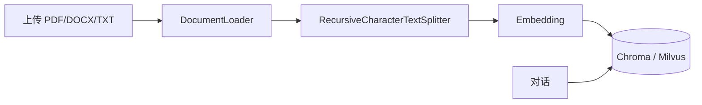
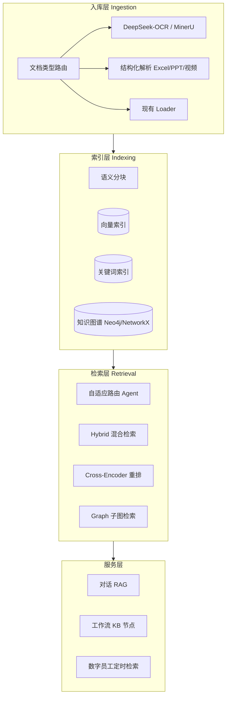

# AI-AGENT 知识库增强规划

> 对照「今日项目体验概览」六大模块（FF-Agentic RAG、Advanced RAG、GraphRAG、多模态 RAG、DeepSeek-OCR、AI HR 数字员工），规划 AI-AGENT 知识库如何从当前基础 RAG 演进到可演示、可落地的完整能力。
>
> 最后更新：2026-06-12  
> 状态：**规划文档，尚未实施**（本文档仅描述计划，不代表代码已实现）

**相关现有文件：**

| 文件 | 说明 |
|------|------|
| `backend/app/knowledge/pipeline.py` | 现有入库流水线 |
| `backend/app/knowledge/loader.py` | 现有文档加载（PDF/DOCX/TXT 等） |
| `backend/app/knowledge/vectorstore.py` | Chroma / Milvus 向量存储 |
| `backend/app/knowledge/chunker.py` | 递归字符分块 |
| `backend/app/api/knowledge.py` | 知识库 API |
| `frontend/src/app/knowledge/page.tsx` | 知识库前端 |
| `backend/app/knowledge/byd_kms.py` | BYD KMS 外部 RAG 对接 |
| `backend/app/knowledge/data/platform-roadmap.md` | 平台总体路线图 |

---

## 一、现状 vs 目标（差距分析）

| 能力 | 图中模块 | 当前平台 | 差距 |
|------|----------|----------|------|
| 可调参 RAG 流水线 | FF-Agentic RAG | 固定 `Loader → Chunk → Embed → Chroma/Milvus` | 缺分路、重排、Agent 决策 |
| 多源 + 混合检索 | Advanced RAG | 纯向量检索 | 无 BM25、无 Rerank、无路由 |
| 图谱问答 + 溯源 | GraphRAG | 无 | 无实体关系、无句级引用 |
| 图文 PDF / OCR | 多模态 RAG + DeepSeek-OCR | `pypdf` 纯文本 | 扫描件/表格/公式/CAD 不可用 |
| 逐句溯源 | 多个模块强调 | 仅有 chunk 预览 | 无 citation UI |
| 垂域 Agent | AI HR 数字员工 | 数字员工 + 技能 + 基础 RAG | 缺 KB 绑定、长期记忆 |

### 当前核心链路



### 目标架构



---

## 二、按模块的实现映射

### 2.1 FF-Agentic RAG（可调参 Agentic 流程）

**目标**：分块、量化、匹配、检索参数可配，Agent 按问题选策略。

| 层级 | 做法 |
|------|------|
| 数据模型 | `KnowledgeBase.metadata` 增加 `rag_profile`：`chunk_strategy`、`top_k`、`score_threshold`、`use_rerank`、`use_hybrid` |
| 后端 | 新建 `backend/app/knowledge/retriever.py`，统一 `RetrieverOrchestrator.retrieve(query, kb_id, profile)` |
| Agentic | 轻量路由 Agent：LLM 输出 `{strategy: "vector\|hybrid\|graph", top_k, filters}`，再执行检索 |
| 前端 | 知识库「高级设置」面板：分块大小、重叠、检索策略、Top-K、是否重排 |
| 工作流 | 新增 `KnowledgeRetrieveNode`，可嵌入现有工作流设计器 |

**Phase 1 即可落地**（预估 2–3 周），在现有 `IngestionPipeline` 上扩展。

---

### 2.2 Advanced RAG 优化范式（五类检索 + 对比）

**目标**：文本 / 结构化 / 图文 PDF / 多模态 / 视频；策略可对比；答案可溯源。

**分类型入库：**

| 类型 | 解析器 | 索引 |
|------|--------|------|
| 文本 | 现有 Loader | 向量 + BM25 |
| 结构化 | `pandas` + Excel/CSV；SQL 表元数据 | 结构化字段 + 文本摘要向量 |
| 图文 PDF | MinerU / DeepSeek-OCR | 文本块 + 图片 embedding |
| 多模态 | 图片 caption + CLIP/多模态 embedding | 双向量库 |
| 视频 | 抽帧 + ASR（Whisper） | 时间戳 chunk |

**检索链路：**

```
Query → 意图分类 → 选索引(向量/BM25/Graph) → 并行召回 → Rerank → 合并 → 带 citation 的 context
```

**技术选型（与现有栈兼容）：**

- 混合检索：`rank_bm25` + 现有 Milvus/Chroma（LlamaIndex 或自研轻量版）
- Rerank：本地 `bge-reranker` 或 Cohere API（工作流 n8n 已有 Reranker 节点可参考）
- 路由：小模型 / 规则 + LLM fallback

**Phase 2**（预估 4–6 周）：先做 **文本 + 结构化 + Hybrid + Rerank + 溯源 UI**。

---

### 2.3 垂域高精度 GraphRAG

**目标**：PDF → 实体关系 → 图谱检索 → 逐句溯源。

| 步骤 | 技术 |
|------|------|
| PDF 深度解析 | MinerU（开源）或 BYD 内网 OCR 服务 |
| 实体/关系抽取 | LLM + schema（人物、组织、指标、时间、因果关系） |
| 图谱存储 | Phase 2a：`NetworkX` + JSON 落 PG；Phase 2b：Neo4j / Nebula |
| 检索 | Microsoft GraphRAG 思路：社区摘要 + 局部子图 + 向量兜底 |
| 溯源 | chunk 存 `page`、`bbox`、`source_sentence_id` |

**与现有代码衔接**：在 `Document.metadata` 和 chunk metadata 中增加 `page`、`block_id`、`entities[]`。

**Phase 3**（预估 6–8 周），依赖 OCR/解析能力先就绪。

---

### 2.4 多模态 RAG 检索 Agent

**目标**：图文混排 PDF 全链路可视化。

- 入库流水线拆成可观测步骤：`parse → ocr → chunk → embed → index`（每步写 `Document.metadata.pipeline_status`）
- 前端知识库文档详情：**解析链路时间线**（类似图中「可视化全链路」）
- Agent：专用「KB 检索 Agent」工具 `kb_search_multimodal(query, kb_id, doc_types)`

可复用 **工作流 + 数字员工**，不必单独做新应用。

---

### 2.5 DeepSeek-OCR-Web（表格 / 公式 / CAD）

**目标**：复杂版面高精度解析。

**集成方式（规划）：**

```python
# backend/app/knowledge/parsers/ocr_deepseek.py
async def parse_with_ocr(file_bytes, filename) -> list[Document]:
    # 调用 DeepSeek-OCR-2 API 或内网部署实例
    # 返回：markdown + 表格 HTML + 公式 LaTeX + 图片 base64 引用
```

**DocumentLoader 路由（规划）：**

```
PDF → 检测是否扫描件/含大量图片 → 是则走 OCR，否则 pypdf
Excel/PPT → markitdown / unstructured
CAD → 暂接 OCR 或标记「待扩展」
```

**部署**：192.168.50.10 上 Ollama/DeepSeek 已有，OCR 可同机 GPU 服务或 API 网关。

**Phase 2 优先**（与制造企业报表、财务 PDF 强相关）。

---

### 2.6 AI HR 数字员工 Agent

**目标**：招聘 / 入职 / 问答 / 绩效 / 员工关系；Multi-Agent + 技能 + 向量 + 记忆。

**这主要是「知识库消费方」，不是 KB 引擎本身：**

| 能力 | 实现 |
|------|------|
| 垂域 KB | 创建 `HR-政策/制度/流程` 知识库，用上述增强 RAG 入库 |
| Agent 绑定 KB | 已有 `knowledge_base_ids`，需对话/员工任务自动 RAG（platform-roadmap P1） |
| Multi-Agent | Orchestrator 或工作流：HR 前台 → 制度检索 Agent → 流程执行 Agent |
| 上下文记忆 | 用户级 memory 表 + 会话摘要（platform-roadmap P2） |
| 技能 | `hr-onboarding-sop`、`hr-policy-qa` 等 SKILL.md |

**Phase 1 可先做**：HR 模板员工 + 绑定 HR 知识库 + 基础 RAG 问答。

---

## 三、分期路线图

### Phase 1（3–4 周）— 夯实基础，立刻可用

1. **KB 配置增强**：`rag_profile`（chunk、top_k、threshold、策略开关）
2. **Hybrid 检索**：BM25 + 向量，RRF 融合
3. **Rerank**：检索后 cross-encoder 重排（Top 20 → Top 5）
4. **Citation 溯源**：检索结果带 `page/chunk_index/source_text`，Chat 回答标注 `[1][2]`
5. **Agent/Chat 自动 RAG**：选 KB 即检索注入（补 platform-roadmap P1）
6. **Excel/CSV 结构化入库**：对接销量分析等业务场景

**预估改动文件：**

- `backend/app/knowledge/retriever.py`（新）
- `backend/app/knowledge/pipeline.py`（扩展）
- `backend/app/knowledge/loader.py`（Excel 分支）
- `backend/app/api/knowledge.py`（检索 API、配置 API）
- `frontend/src/app/knowledge/page.tsx`（高级设置 + 溯源展示）

---

### Phase 2（4–6 周）— Advanced RAG + OCR

1. **DeepSeek-OCR / MinerU** 接入，扫描 PDF、复杂表格
2. **文档类型自适应路由**（文本 / 扫描 / 结构化）
3. **检索策略对比页**：同一问题展示 vector / hybrid / hybrid+rerank 结果并排
4. **入库流水线可视化**（前端进度条 + 日志）
5. **PPT/Word 增强**：markitdown 或 unstructured

---

### Phase 3（6–10 周）— GraphRAG + 多模态 + 视频

1. **实体关系抽取 + 图谱索引**
2. **GraphRAG 检索**与向量检索融合
3. **图片/多模态 embedding**（CLIP 或 Qwen-VL embedding）
4. **视频 ASR + 分段索引**
5. **Agentic RAG 完整版**：LLM 规划检索步骤（分解 → 多跳 → 汇总）

---

### Phase 4（与业务并行）— 垂域落地

1. **HR 数字员工包**：模板 + HR KB + 工作流
2. **制造/财务垂域 GraphRAG**（制度、管报、政策文件）
3. **BYD KMS 与本地 KB 联邦检索**（已有 `byd_kms.py`，可做统一 Retriever 门面）

---

## 四、统一技术架构（规划目录结构）

```
backend/app/knowledge/
├── loader.py              # 现有，扩展路由
├── chunker.py             # 现有，增加 semantic/markdown-aware 分块
├── pipeline.py            # 现有，编排 ingest
├── retriever.py           # 新：统一检索入口
├── reranker.py            # 新
├── hybrid.py              # 新：BM25 + vector RRF
├── router.py              # 新：文档类型 & 检索策略路由
├── citation.py            # 新：溯源格式化
├── parsers/
│   ├── ocr_deepseek.py
│   ├── mineru.py
│   ├── excel.py
│   └── structured.py
├── graph/
│   ├── extractor.py       # 实体关系
│   └── store.py           # 图谱存储
└── profiles/
    └── default.yaml       # 预设：通用 / HR / 财务 / 制造
```

**存储规划：**

| 数据 | 存储 |
|------|------|
| 原文 | 现有 `uploads/` |
| 向量 | Chroma（开发）/ Milvus（192.168.50.10 生产） |
| 关键词 | PostgreSQL `tsvector` 或 Elasticsearch（可选） |
| 图谱 | PostgreSQL JSONB → Neo4j（规模化后） |
| 流水线状态 | `Document.metadata.pipeline` |

---

## 五、与现有平台的衔接

| 现有能力 | 如何复用 |
|----------|----------|
| 工作流设计器 | 新增 `KnowledgeIngestNode`、`KnowledgeRetrieveNode` |
| 数字员工 | 任务配置加 `knowledge_base_ids`，定时报告自动 RAG |
| 对话沉淀 | 已有 export to KB，增强后可进 Graph |
| BYD KMS | 作为外部 Retriever 源，与本地 KB 并列 |
| 技能库 | 每个 RAG 策略写进 SKILL（如 `graphrag-qa`、`hybrid-retrieval`） |

---

## 六、优先级建议（结合业务场景）

| 优先级 | 项 | 说明 |
|--------|-----|------|
| **P0** | Hybrid + Rerank + Citation + Excel 入库 | 支撑销量/财务分析 |
| **P0** | Chat/Agent 自动 RAG + KB 参数可配 | 对话与 Agent 默认可检索 |
| **P1** | DeepSeek-OCR | 复杂 PDF、扫描件 |
| **P1** | 检索策略对比 UI | 演示/POC 效果 |
| **P2** | GraphRAG | 制度、合同、HR 高精问答 |
| **P2** | HR 数字员工模板包 | 垂域落地 |

---

## 七、与 platform-roadmap 的关系

本规划是对 `backend/app/knowledge/data/platform-roadmap.md` **§3.7 对话与知识** 的展开：

| platform-roadmap 条目 | 本规划对应 |
|----------------------|------------|
| P1 Agent 绑定知识库 | Phase 1 §5 |
| P1 混合检索 | Phase 1 §Hybrid |
| P2 文档增量更新 | Phase 2+ 后续迭代 |
| P2 多模态知识 | Phase 2–3 OCR + 多模态 |

实施时以 **Phase 1** 为第一个开发里程碑；每完成一阶段更新本文档状态与 `platform-roadmap.md` 勾选进度。

---

## 八、验收标准（按 Phase）

### Phase 1 验收

- [ ] 知识库可配置 chunk / top_k / hybrid / rerank 开关
- [ ] 上传 Excel 可入库并可检索
- [ ] 检索 API 返回带 citation 的 chunks
- [ ] Chat 绑定 KB 后回答含 `[1][2]` 引用
- [ ] 知识库页可预览 chunk 与原文对应关系

### Phase 2 验收

- [ ] 扫描 PDF 经 OCR 入库成功
- [ ] 同一 query 可对比 vector / hybrid / hybrid+rerank 结果
- [ ] 文档入库过程可在 UI 查看步骤状态

### Phase 3 验收

- [ ] 指定垂域文档可抽取实体关系并图谱检索
- [ ] GraphRAG + 向量融合检索可用
- [ ] 多模态文档（图文 PDF）检索命中图片相关段落

### Phase 4 验收

- [ ] HR 数字员工模板 + HR 知识库一键导入
- [ ] BYD KMS 与本地 KB 统一检索入口

---

*本文档为规划性质，不包含实现代码。开发启动前需单独评审 Phase 1 接口设计与资源（GPU/OCR 服务、Milvus 等）。*
