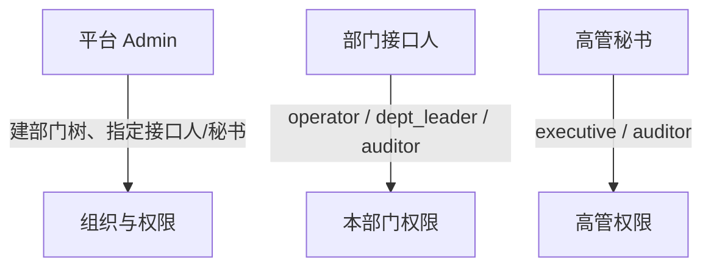

# 组织权限与分层赋权说明

本文档说明 AI-AGENT 生产级 **组织 RBAC**、**部门接口人赋权**、**高管秘书赋权** 的设计与日常操作，面向平台管理员、部门接口人与高管秘书。

**相关文档：** [用户操作手册](./用户操作手册.md) · [打包部署方案](./打包部署方案.md) · [platform-roadmap.md](../backend/app/knowledge/data/platform-roadmap.md)

---

## 1. 设计目标

| 目标 | 说明 |
|------|------|
| 默认最小权限 | 普通员工（`operator`）仅管理自己的数字员工，**不能**访问运营大屏 |
| 层级可见 | 部门负责人 / 接口人可查看本部门及**所有下级部门**员工的数字员工与运行数据 |
| 高管横切 | 总监级及以上由**高管秘书**单独开通大屏与 `executive` 角色 |
| 职责分离 | **业务负责人**（leader）与**权限接口人**（liaison）分开；接口人管赋权，不必然管业务 |
| 前后端一致 | 菜单隐藏 + API 403，不仅藏前端 |

---

## 2. 角色一览（8 个）

| 角色代码 | 中文名 | 典型人群 | 数字员工 | 大屏 `/screen` | 组织管理 |
|----------|--------|----------|----------|----------------|----------|
| `super_admin` | 系统管理员 | IT / 平台运维 | 全部 | ✓ | ✓ 全部 |
| `org_admin` | 组织管理员 | HR / 行政 | 读 | — | ✓ 组织树与用户 |
| `executive` | 高管 | CFO、VP | 全公司只读 | ✓ | — |
| `dept_leader` | 部门负责人 | 部长、中心经理 | 子树读写 | ✓ 子树 | — |
| `operator` | 业务操作员 | 一线员工 | **仅自己** | ✗ | — |
| `auditor` | 审计只读 | 内审 | 授权范围只读 | ✓ | — |
| `dept_liaison` | 部门接口人 | 各部门指定 1 人 | 读 | — | ✓ **本部门子树赋权** |
| `executive_assistant` | 高管秘书 | Admin 指定 | 读 | ✓ | ✓ **高管名单赋权** |

> 新注册用户默认 `operator`。一人可兼多角色，权限取**并集**。

---

## 3. 组织架构字段

### 3.1 部门（`departments`）

| 字段 | 说明 |
|------|------|
| `leader_user_id` | 业务负责人 |
| `liaison_user_id` | **权限接口人**（指定后该用户可进入「本部门权限」页） |
| `dept_tier` | `business`（默认）或 `executive`（高管办公室） |
| `path` | 物化路径，如 `/根部门ID/子部门ID/`，用于子树查询 |

### 3.2 用户（`users`）

| 字段 | 说明 |
|------|------|
| `primary_department_id` | 主部门 |
| `user_tier` | `staff` / `director` / `executive`（秘书名单池依据） |

---

## 4. 三层日常分工



### 4.1 平台 Admin（一次性 +  occasional）

路径：**设置 → 组织与权限**（`/settings/organization`）

1. 建立部门树（可设 `dept_tier=executive` 作为高管办公室）
2. 每个一级/二级部门在列表中选择 **权限接口人**（`liaison_user_id`）
3. 给用户设置 **人员层级**（`staff` / `director` / `executive`）
4. 指定 **1～2 人** 为 `executive_assistant`（高管秘书）角色
5. 可选：给用户分配 `dept_liaison` 角色并绑定管辖部门

### 4.2 部门接口人

路径：**设置 → 本部门权限**（`/settings/delegation/dept`）

- 仅见 **本部门 + 所有下级** 用户
- 可赋角色：`operator`、`dept_leader`、`auditor`
- 可调整目标用户 **主部门**（须在子树内）
- **不能**赋 `executive`、不能改组织树、不能改自己权限

### 4.3 高管秘书

路径：**设置 → 高管权限**（`/settings/delegation/executive`）

- 仅见 **高管名单池**：`user_tier` 为 `director`/`executive`、或已有 `executive` 角色、或在 `dept_tier=executive` 部门下的用户
- 可赋角色：`executive`、`auditor`
- **不能**管普通员工、不能建部门

---

## 5. 数字员工与运营大屏

| 能力 | operator | dept_leader / 接口人子树 | executive | super_admin |
|------|:--------:|:------------------------:|:---------:|:-----------:|
| 列表可见范围 | 仅自己 | 子树内所有 owner | 全公司 | 全公司 |
| 创建/修改 | 自己的 | 子树内（leader 可写下属） | 只读 | 全部 |
| 大屏 `/screen` | **不可见** | 子树统计 | 全公司 | 全公司 |

大屏 API（`/api/v1/dashboard/overview`、`/stream`）需 `dashboard:view`；SSE 需登录（支持 `?token=`）。

---

## 6. API 参考

| 路径 | 说明 | 所需权限 |
|------|------|----------|
| `GET/POST/PATCH /organization/departments` | 部门 CRUD | `org:manage` |
| `GET/PATCH /organization/users/{id}` | 全量用户与角色 | `org:manage` |
| `GET /organization/delegation/context` | 当前用户赋权能力 | 任一赋权权限 |
| `GET /organization/delegation/dept-users` | 接口人可见用户 | `users:delegate:dept` 或部门 liaison |
| `PATCH /organization/delegation/dept-users/{id}` | 接口人赋权 | 同上 |
| `GET /organization/delegation/executive-users` | 秘书可见用户 | `users:delegate:exec` |
| `PATCH /organization/delegation/executive-users/{id}` | 秘书赋权 | 同上 |
| `GET /organization/audit-logs` | 赋权审计 | 赋权人或 org 管理员 |
| `GET /auth/me` | 返回 `roles`、`permissions`、`data_scope` | 登录 |

---

## 7. 赋权审计

所有接口人 / 秘书 / Admin 的赋权操作写入 `permission_audit_logs`，包含：

- 操作人、目标用户、动作类型（`dept_delegation` / `executive_delegation` / `org_admin_update`）
- 变更前后角色 JSON

查询：`GET /api/v1/organization/audit-logs?limit=50`

---

## 8. 生产上线检查清单

- [ ] 修改默认管理员密码与 `SECRET_KEY`
- [ ] Admin 建立部门树并指定各部门 **接口人**
- [ ] 指定 **高管秘书** 并维护总监级 `user_tier`
- [ ] 确认普通员工侧边栏 **无**「运营大屏」
- [ ] 确认接口人 **无**「高管权限」入口
- [ ] 重启后端后数据库自动迁移（`departments.liaison_user_id`、`users.user_tier` 等）

---

## 9. 示例：制造企业财务

```
全公司
├── 高管办公室 (dept_tier=executive)
├── 财务中心 (接口人: 张敏)
│   ├── 管理会计部
│   ├── 成本部
│   └── 资金部
└── 制造中心 (接口人: 李工)
```

- **张敏**：本部门权限 → 给成本部经理 `dept_leader`，给会计 `operator`
- **王秘书**（`executive_assistant`）：高管权限 → 给 CFO 勾选 `executive`
- **王会计**：仅见自己的数字员工，无大屏

---

## 10. 数据库与迁移

启动时 `init_db` 自动：

- 创建 `departments`、`user_departments`、`user_roles`、`permission_audit_logs`
- 补列 `users.primary_department_id`、`users.user_tier`、`digital_employees.department_id`
- 种子根部门「全公司」；`admin` 赋 `super_admin`

无需手工 SQL；PostgreSQL / SQLite / VastBase 均支持轻量 `ALTER TABLE` 补丁。
