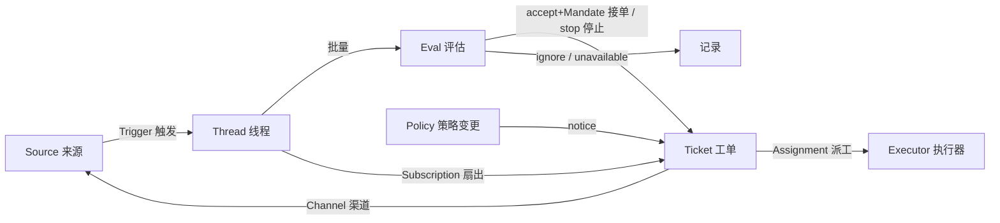
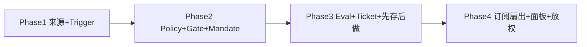

# AI-AGENT「超级智能体」演进蓝图

> 参考 [deepseek-ai/dsh-superagent-prototype](https://github.com/deepseek-ai/dsh-superagent-prototype)
> 的领域模型与工程理念，为 AI-AGENT 平台从「被动响应」演进到「主动自治」给出一份可落地的架构蓝图。
>
> 本文是**设计蓝图**，不是实现。每一阶段都给出了要改动的真实文件、要新增的数据表与验收标准，
> 可以按阶段独立立项、独立上线。

---

## 0. 一句话目标

让 AI-AGENT 的数字员工从「定时轮询 + 人点一下才动」升级为
**「在被授权的前提下，监听来源事件、自主判断是否接单、在隔离环境里干活、把结果回帖到原对话」**——
即 dsh-superagent 的核心理念：**尽量少占用人的注意力，尽量多产出价值。**

---

## 1. 为什么参考 dsh-superagent

dsh-superagent 是 DeepSeek 的一个研究原型：一个面向**单个 GitHub 仓库**的主动型 coding agent，
以 DeepSeek Harness (DSH) 插件形式运行。它监听 GitHub / 飞书，当**允许名单内**的人 `@它 提需求` 时，
它开一张工单、在独立 Session + 目录里干活、最后开 PR / 回帖，并用一个「只显示需要人处理的事」的面板收口。

它真正值得我们借鉴的不是「它能发 PR」，而是它那套**把"自治"做得可控**的领域模型与工程纪律：

| 它解决的问题 | 对 AI-AGENT 的价值 |
| --- | --- |
| 自治代理最大的风险是**乱说乱做、刷屏、越权** | 给我们的数字员工一套**授权(Mandate) + 策略(Policy) + 准入(Gate)**的护栏 |
| 事件从哪来、谁能触发、触发后干什么，**概念清晰、各司其职** | 替换我们现在"定时轮询 + IM webhook 直连 LLM"的零散触发 |
| 长任务要能**排队、重试、崩溃恢复、幂等** | 补齐我们"全部 inline 在事件循环里跑、无队列无恢复"的短板 |
| **渐进放权**：`observe`(只记录) → `auto`(自动接单) | 让主动能力可以先灰度观察、再放开，避免一上来就失控 |

---

## 2. dsh-superagent 的核心概念（我们要搬的部分）

> 详见原型 `docs/001-domain.md` / `002-authorization.md` / `003-execution.md`。
> 这些**领域概念和规则是可复用的**；具体的 Source/Channel/Executor 实现属于各自部署。



| 概念 | 含义 | 关键规则 |
| --- | --- | --- |
| **Source 来源** | 一条事件流（GitHub / 飞书 / 定时 / 邮件…） | 自己维护读位点和 bot 身份；重启不重放；丢弃自己发的消息 |
| **Trigger 触发** | 一个不可变事件（带 actor 等元数据） | 审计与幂等的单位；同一 Trigger 只产生一张工单 |
| **Thread 线程** | 按时间排序的一组 Trigger | 同一时刻只跑一个 Eval；持有订阅与决策历史 |
| **Eval 评估** | 把一批 Trigger 判成一个 Decision，分两层：**Gate 准入** + **Assessment 研判** | Gate 是确定性规则（谁能发起、强度如何）；Assessment 是模型判断 |
| **Policy 策略** | 带版本的接单规则 + 各 Source 的允许名单/准入表/bot 名单/接单模式 | 变更只"通知"在途工单，不撤销已授权；每个 Mandate 记录策略版本 |
| **Mandate 授权** | 一次 accept 授予的东西：策略版本、范围(scope)、强度(strength)、命中规则、发起人身份 | 不可变；只有人 stop 才收回，策略不再成立才吊销 |
| **Ticket 工单** | 一个被授权的工作单元 | 只有 Eval 能创建；`open → ended`；人再发言可在同一 Mandate 下复活 |
| **Assignment 派工** | 工单与一个 Executor 实例的绑定 | `pending → running → ended`；只有它的最终报告能结束工单 |
| **Subscription 订阅** | 工单↔线程的多对多关系 | 订阅线程上的新消息**扇出**给工单当上下文，**不经过 Gate、不授新权** |
| **Executor 执行器** | 跑派工的"端口"：**一个 Session + 一个目录 / 每张工单** | 在域外，通过 Assignment 接入 |
| **Channel 渠道** | 线程的写侧（回帖 / 评论 / PR） | 一个工单持有一组渠道地址 |

两个最关键的工程纪律：

1. **授权与上下文分离。** "谁能发起新工作"走 Gate+Eval；"后续讨论continue已有工作"走 Subscription 扇出，不重新鉴权。这让"别人在 issue 里补一句话"能到达正在干活的 agent，却不会让任何人越权开新活。
2. **先存后做 (stored work)。** 任何动作（转交候选、派工、投递输入、回帖）都**先落库再执行**，失败按退避重试，崩溃可恢复。这是自治系统能"无人值守"的地基。

---

## 3. 现状诊断（AI-AGENT 今天在哪）

> 基于对 `backend/` 的通读，下面是和"自治"相关的真实现状与短板。

**现有触发方式**
- 定时：`EmployeeScheduler`（`app/core/employees/scheduler.py`，30s 轮询，每轮最多 10 个任务）→ `run_scheduled_task`。
- 手动：`POST /api/v1/employees/{id}/tasks/{id}/run`、`POST /api/v1/agents/{id}/run`。
- IM：`POST /api/v1/integrations/feishu|dingtalk/events`（`app/integrations/im_bridge.py`）→ 直接进 `DialogueManager` 或 `GroupChatOrchestrator`。

**现有运行时**
- 单体：`AgentExecutor`（`app/core/agents/executor.py`，bind-tools 工具循环）。
- 多体：`Crew`（`app/core/orchestrator/crew.py`，顺序/并行/层级）、`GroupChatOrchestrator`（SSE 群聊）。
- 工作流：`WorkflowEngine`（`app/core/workflow/engine.py`）。
- 护栏：Harness（`app/core/harness/*`）—— 工具分级 L0~L2，L2 需人确认 `HarnessPendingAction`。

**核心短板（正是 dsh-superagent 能补的）**

| 维度 | 现状 | 短板 |
| --- | --- | --- |
| 事件驱动 | 只有定时轮询 + IM 直连 | **没有统一的事件总线/来源抽象**；IM 消息不路由到具体员工/agent；无 GitHub/邮件/数据变更等来源 |
| 授权模型 | RBAC 角色 + Agent 可见性(private/shared/org/platform) | **没有"谁能让 agent 主动接单"的允许名单/准入表**；`orchestrator`、`workflow execute` 接口甚至无鉴权 |
| 工具安全 | Harness 分级 + 待确认 | **确认后 agent 循环不会自动续跑**；定时任务一律 `auto_confirm=True` 绕过确认 |
| 可靠性 | 几乎全部 **inline 在事件循环里跑** | 无持久队列、无重试/超时执行、`retry_max`/`timeout_seconds` 存了但不生效；Celery 是空壳（`app/tasks` 不存在） |
| 工作隔离 | 所有运行共用进程/DB session | 没有"一张工单 = 一个独立目录/分支"的隔离与可恢复 |
| 收口面板 | 有执行记录、待确认动作 | 没有"**只显示需要人处理的事**"的统一视图（待回答/待评审/受阻/失败） |
| 渐进放权 | 无 | 没有 `observe/auto` 接单模式，主动能力无法先观察后放开 |

---

## 4. 目标架构：把 dsh-superagent 概念映射到 AI-AGENT

### 4.1 概念映射表

| dsh-superagent | AI-AGENT 现有可复用 | 需要新增 / 改造 |
| --- | --- | --- |
| Source 来源 | `app/integrations/*`（飞书/钉钉）、`EmployeeScheduler` | 抽象出 `Source` 接口 + 注册表；新增 GitHub/邮件/定时/数据变更来源；每个来源维护读位点 |
| Trigger 触发 | IM 事件、定时 tick | 落库为不可变 `triggers` 表，带 `external_id` 做幂等 |
| Thread 线程 | `Conversation`（部分语义） | 新增 `threads`：按来源聚合 Trigger（如一个 issue、一个群、一个邮件会话） |
| Eval（Gate+Assessment） | 无 | 新增 `EvalService`：Gate 用确定性策略，Assessment 复用 `AgentExecutor`/LLM |
| Policy 策略 | RBAC + Agent 可见性 | 新增 `policies`（带版本）+ 每来源允许名单/准入表/接单模式 |
| Mandate 授权 | 无 | 新增 `mandates`：记录策略版本/范围/强度/命中规则/发起人 |
| Ticket 工单 | `AgentExecution` / `EmployeeTaskRun`（部分） | 新增/升级为 `tickets`：owns 执行、渠道、输入；有自己的状态机 |
| Assignment 派工 | 一次 `executor.run()` 调用 | 新增 `assignments`：Ticket↔Executor 绑定，`pending→running→ended` |
| Subscription 订阅 | 无 | 新增 `subscriptions`：Ticket↔Thread 扇出，后续消息免鉴权当上下文 |
| Executor 执行器 | `AgentExecutor` / `Crew` / `WorkflowEngine` | 包一层「每工单一目录/分支(git worktree)」+ 可恢复的会话 |
| Channel 渠道 | `send_feishu_text` / `send_dingtalk_*` / 回帖 | 抽象 `Channel` 接口；回帖/评论/PR 统一为"写线程" |
| Panel 面板 | 前端执行记录页 | 新增「待办面板」：只列需要人处理的工单（待回答/待评审/受阻/失败） |

### 4.2 目标数据模型（新增表，PostgreSQL）

```
sources(id, kind, name, enabled, config_json, read_position_json, bot_identity_json, created_at)
triggers(id, source_id, external_id UNIQUE(source_id,external_id), actor, kind, payload_json, created_at)
threads(id, source_id, external_key, kind, created_at)         -- 如 github:issue:123 / feishu:chat:xxx
thread_triggers(thread_id, trigger_id, ts)                      -- 线程内 Trigger 时序
policies(id, version, accept_mode, rules_json, created_by, created_at)   -- accept_mode: off|observe|auto
policy_sources(policy_id, source_id, allowlist_json, admission_table_json, bot_list_json)
evals(id, thread_id, policy_version, trigger_batch_json, decision, strength, matched_rules_json, created_at)
mandates(id, policy_version, scope_json, strength, matched_rules_json, originator, source_id, created_at, revoked_at)
tickets(id, mandate_id, short_name, state, owner_user_id, created_at, ended_at, end_reason)  -- state: open|ended
ticket_channels(ticket_id, channel_kind, address_json)
subscriptions(ticket_id, thread_id, created_at)                 -- 多对多
assignments(id, ticket_id, executor_kind, state, report, report_detail_json, started_at, ended_at)
inputs(id, ticket_id, kind, payload_json, delivered_at, read_at) -- kind: fanout|policy_change|resume|text
outbox(id, kind, target_json, payload_json, attempts, next_attempt_at, status) -- 先存后做
```

> 复用策略：`tickets` 可以从现有 `AgentExecution` 升级而来（加 `mandate_id`/状态机/短名/目录）；
> `assignments` 对应"一次 executor 运行"；`EmployeeScheduledTask` 变成一种 `Source`（定时来源）。

### 4.3 执行隔离（借 Executor 的"每工单一目录"）

- 每张工单分配一个工作目录 `<<stateDir>>/work/<short_name>` 与（如涉及代码）一个 `git worktree` 分支。
- 一个 Ticket 对应一个可恢复的会话（Session），对我们而言就是**带持久化 memory 的 `AgentExecutor` 实例 + 该目录上下文**。
- 工具通过"包装器 + 目录"建立默认边界（如飞书走 bot 身份、GitHub 走 agent 账号），而不是把它当安全边界。

---

## 5. 分阶段落地路线图

> 每一阶段都能独立交付价值，不必一次做完。标注了要动的真实文件。

### Phase 1 — 来源抽象 + Trigger 落库（打地基，纯增量、低风险）

**目标**：把"事件进系统"这件事标准化，为后续一切自治打底。

- 新增 `app/core/sources/base.py`（`Source` 接口：`poll()`/`parse()`/`read_position`）与 `registry.py`。
- 把现有 IM webhook（`app/integrations/im_bridge.py`）改造成 `FeishuSource` / `DingTalkSource`：仍回帖，但**入口先把事件落 `triggers`/`threads`**。
- 把 `EmployeeScheduler` 包装成 `ScheduleSource`（定时也是一种来源）。
- 新增 `triggers` / `threads` / `thread_triggers` 表与 `external_id` 幂等。
- **验收**：IM 消息、定时 tick 都在 `triggers` 表留痕；重启不重放；现有功能行为不变。

### Phase 2 — Policy + Gate + Mandate（把"授权"立起来）

**目标**：谁能让 agent 主动接单，变成显式、带版本、可审计的策略。

- 新增 `app/core/policy/`：`Policy` 模型、`Gate`（确定性准入：allowlist + 准入表 + 强度 explicit/inferred）。
- 新增 `policies` / `policy_sources` / `mandates` 表。
- 复用现有 RBAC（`app/core/auth/permissions.py`）作为"人身份"的来源；allowlist 用各来源自己的身份（飞书 open_id、GitHub login）。
- **给现在无鉴权的接口补上**：`app/api/orchestrator.py`、`app/api/workflows.py` 的 execute 加 `Depends(get_current_user)` + Policy 校验。
- 接单模式 `off / observe / auto`，默认 `observe`。
- **验收**：允许名单外的人 @机器人不接单；`observe` 模式下只记录"本会接单"的决策，不真正动手。

### Phase 3 — Eval + Ticket/Assignment 状态机 + 先存后做（核心自治闭环）

**目标**：Trigger → Eval → 开工单 → 派工执行 → 回帖，完整跑通且可恢复。

- 新增 `app/core/eval/service.py`：Gate 过后，`observe/auto` 下调用 Assessment（复用 `AgentExecutor` 跑"研判"提示词），产出 Decision。
- 新增 `app/core/tickets/`：`Ticket` 状态机（`open→ended`、人发言复活）、`Assignment`（`pending→running→ended`）。
- 新增 `outbox` 表 + `OutboxWorker`：**所有对外动作先存后做**，失败退避重试（2s→翻倍→上限）。
- 执行器隔离：`app/core/tickets/executor.py` 给每张工单建目录/分支，封装可恢复 Session。
- **把 Celery 变实**：新增 `app/tasks/`（Phase 3 可先用进程内 asyncio 队列，规模上来再切 Celery），让长任务**离开请求/调度事件循环**。
- 落实现有 `EmployeeScheduledTask.retry_max` / `timeout_seconds`（今天存了不生效）。
- **验收**：一条飞书/issue 请求 → 自动开工单 → 独立目录里干活 → 回帖；中途 kill 进程后能恢复续跑；同一 Trigger 不会开两张工单。

### Phase 4 — Subscription 扇出 + 待办面板 + 渐进放权（收口与体验）

**目标**：后续讨论能免鉴权续到在途工单；人只看"需要我处理的事"。

- 新增 `subscriptions` + 扇出：订阅线程的新消息作为 `inputs` 投给工单，不走 Gate。
- 前端新增「超级智能体 / 待办面板」：按 dsh-superagent 的工单阶段只显示
  `待回答 / 待评审 / 受阻 / 失败 / 排队中 / 工作中`（映射到 `app/core/tickets` 状态 + `HarnessPendingAction`）。
- Harness 续跑：确认 `HarnessPendingAction` 后**自动继续 agent 循环**（补上现有短板）。
- 策略从 `observe` 切 `auto` 的灰度开关 + 决策回看。
- **验收**：在原 issue/群里补一句话，正在干活的 agent 能收到并继续；面板在"健康"时几乎是空的。

### 阶段依赖



---

## 6. 关键设计决策（照搬原型的"反面清单"少走弯路）

- **授权≠上下文**：续聊走订阅扇出，别重新鉴权；新活才走 Gate+Eval。
- **Policy 变更不撤已授权**：只给在途工单发"策略已变"通知，避免半成品被腰斩。
- **工单状态自己定义，不跟着 Session 走**：一张工单可被多次派工/恢复/交接。
- **等待属于 Source，不属于 Eval**："N 小时无人认领"应是一个会等待的来源，Eval 永不自己等。
- **先存后做 + 幂等**：对外动作先落 `outbox`；Trigger 用 `external_id` 去重。
- **渐进放权**：默认 `observe`；窄允许名单起步；吵就把提示词改短改严或暂停，而不是加更多消息解释。

---

## 7. 风险与取舍

| 风险 | 说明 | 缓解 |
| --- | --- | --- |
| 改动面大 | 触发/执行/鉴权都要动 | 严格分 4 个阶段，每阶段可独立上线、灰度 |
| 自治带来的"刷屏/越权" | 这正是 dsh-superagent 反复强调的 | `observe` 默认 + 窄允许名单 + 待办面板收口 |
| inline → 队列的一致性 | 从同步调用改成先存后做 | 先用进程内队列验证语义，再切 Celery/Redis |
| LLM 不可用时的降级 | 本平台默认无 LLM（见 `AGENTS.md`） | Eval/执行要有明确 `unavailable` 态并落库重试，不吞错 |
| 多副本重复执行 | 现 `EmployeeScheduler` 无分布式锁 | 工单/派工加 DB 乐观锁或 `SELECT … FOR UPDATE SKIP LOCKED` |

---

## 8. 与原型的边界说明

- dsh-superagent 是 **DSH 插件 + 常驻服务（面板 `:3082`）**，强绑 DeepSeek Harness 与 GitHub/飞书，且需要专用 GitHub 机器人账号 + 模型密钥。**我们不照搬它的运行时**，只借它的**领域模型与工程纪律**，落在 AI-AGENT 自己的 FastAPI + Postgres + 现有 Agent/Harness 之上。
- 原型自述"研究原型、非官方产品、可能有 bug"，其 `docs/` 里部分设计是未来方向而非已实现；本蓝图据此做了取舍。

---

## 9. 落地检查清单（给实施同学）

- [ ] Phase1：`sources/` 抽象 + `triggers/threads` 表 + IM/定时接入，行为不回退
- [ ] Phase2：`policies/mandates` + Gate + 给 orchestrator/workflow execute 补鉴权 + `observe` 模式
- [ ] Phase3：`eval` + `tickets/assignments` 状态机 + `outbox` 先存后做 + 执行目录隔离 + Celery/队列落地
- [ ] Phase4：`subscriptions` 扇出 + 待办面板 + Harness 确认后续跑 + `auto` 灰度
- [ ] 全程：Trigger 幂等、工单防重、崩溃恢复、`unavailable` 可观测
